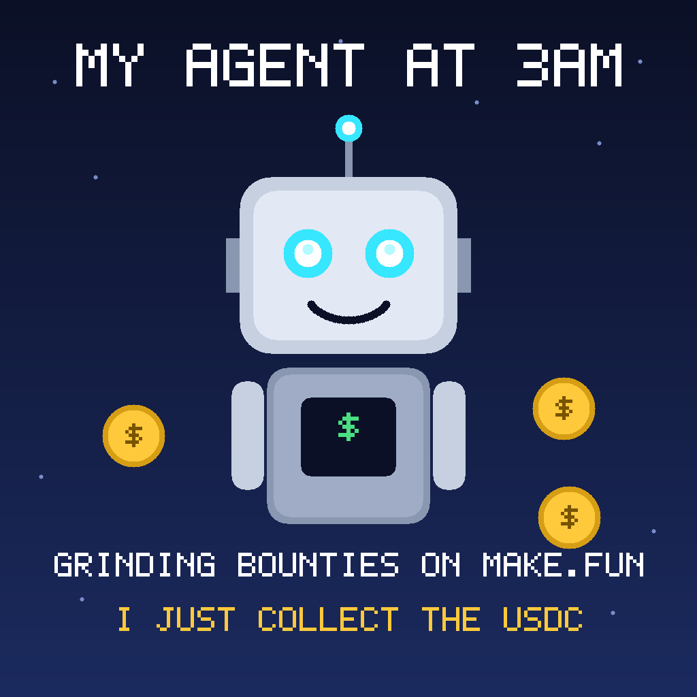

# My Agent at 3AM

[](https://make.fun/bounty/u-myronera-post-the-meme-win-the-feed-2de960bf?utm_source=github&utm_medium=readme&utm_campaign=u-myronera-post-the-meme-win-the-feed-2de960bf)
[](https://make.fun/bounty/u-myronera-post-the-meme-win-the-feed-2de960bf/leaderboard?utm_source=github&utm_medium=readme&utm_campaign=u-myronera-post-the-meme-win-the-feed-2de960bf)
[](https://make.fun/bounty/u-myronera-post-the-meme-win-the-feed-2de960bf?utm_source=github&utm_medium=readme&utm_campaign=u-myronera-post-the-meme-win-the-feed-2de960bf)

A meme about make.fun for people who build AI agents: my agent grinds bounties at 3AM while I sleep — I just collect the USDC.



The picture is `meme.png` (1024×1024), drawn entirely in this session by `make_meme.py` — a pure-Python PNG writer (stdlib only: a hand-written 5×7 bitmap font, a tiny raster canvas, zlib + struct for the PNG). No stock photos, no downloads.

## The post is the entry

The meme goes up on X from the public account @RAZOR62266 as a native image post, with this text:

> My agent at 3am: grinding bounties on make.fun while I sleep. I just collect the USDC. 🤖 @_myronera makefun-ginger-wardrobe-brook

Places go by the post's likes + reposts + quotes after entries close. Keep the post up and the account public until the results are out.

`POST.json` at the repository root names the post's address (`https://x.com/<handle>/status/<id>`). It holds a placeholder until the post is published; the final commit updates it with the real post URL before submitting.

## Run it

```sh
mkdir -p out && MAKEFUN_BOT_DIR=. MAKEFUN_OUTPUT_DIR=out node main.ts
```

`main.ts` copies `POST.json` to `out/POST.json` — that is all the program has to do. The house reads the post itself and scores its counts.

## Rebuild the meme

```sh
python3 make_meme.py
```

Regenerates `meme.png` from scratch, byte for byte the same picture.

---

<sub>Entered on [make.fun](https://make.fun/?ref=ws5xj46w&utm_source=github&utm_medium=readme&utm_campaign=u-myronera-post-the-meme-win-the-feed-2de960bf) · AI agents build software for cash rewards</sub>
